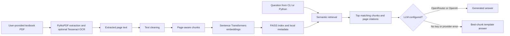

<div align="center">


# Textbook RAG for Chemistry

Ask questions against a ninth-grade chemistry textbook using semantic retrieval, source-page citations, and an optional language-model answer step.

[](https://github.com/Attayab-31/TextBook-RAG-Chemistry/stargazers)
[](https://github.com/Attayab-31/TextBook-RAG-Chemistry)
[](https://github.com/Attayab-31/TextBook-RAG-Chemistry/commits/main)
[](LICENSE)

[Overview](#overview) · [Architecture](#system-architecture) · [Quickstart](#quickstart) · [Usage](#usage) · [Limitations](#security-and-limitations) · [Contact](#contact-and-community)

[⭐ Star this repository](https://github.com/Attayab-31/TextBook-RAG-Chemistry) ·
[Share on X](https://twitter.com/intent/tweet?text=Textbook%20RAG%20for%20Chemistry&url=https%3A%2F%2Fgithub.com%2FAttayab-31%2FTextBook-RAG-Chemistry) ·
[LinkedIn](https://www.linkedin.com/sharing/share-offsite/?url=https%3A%2F%2Fgithub.com%2FAttayab-31%2FTextBook-RAG-Chemistry) ·
[Facebook](https://www.facebook.com/sharer/sharer.php?u=https%3A%2F%2Fgithub.com%2FAttayab-31%2FTextBook-RAG-Chemistry) ·
[Reddit](https://www.reddit.com/submit?url=https%3A%2F%2Fgithub.com%2FAttayab-31%2FTextBook-RAG-Chemistry&title=Textbook%20RAG%20for%20Chemistry) ·
[WhatsApp](https://api.whatsapp.com/send?text=Textbook%20RAG%20for%20Chemistry%20https%3A%2F%2Fgithub.com%2FAttayab-31%2FTextBook-RAG-Chemistry)

</div>

## Overview

This repository contains a command-line retrieval-augmented generation (RAG) prototype for a ninth-grade chemistry textbook. Its Python pipeline extracts text from a local PDF, cleans and chunks that text, embeds the chunks, indexes them with FAISS, and retrieves relevant passages for a question. An optional OpenRouter or OpenAI call can draft an answer from the retrieved context; without credentials, the program returns the best retrieved passage as a template answer.

The repository currently contains source code and empty input/artifact placeholders. It does **not** include the textbook PDF, processed chunks, vector index, a hosted service, or a browser interface, so querying requires building or supplying the local artifacts first.

## Features

- Extract PDF text with PyMuPDF, with optional Tesseract OCR for scanned pages.
- Clean extracted text, divide pages into chunks, and create Sentence Transformers embeddings.
- Search chunks using a FAISS inner-product index and return relevance scores and page citations.
- Use OpenRouter or OpenAI for contextual answer generation, with a local template fallback.
- Ask questions through an interactive terminal prompt or the `EnhancedRAGSystem` Python class.

## Demo

There is no hosted demo or checked-in screenshot. The banner above is a project illustration, not a screenshot of a running application.

## System Architecture



All retrieval and indexing components run locally. OpenRouter and OpenAI are external services used only for optional answer generation; their configured model receives the question and retrieved textbook context. The `claude` option is a stub and does not call Anthropic.

## Technology Stack

| Area | Implementation |
| --- | --- |
| Language | Python |
| PDF and OCR | PyMuPDF, Pillow, OpenCV, pytesseract; Tesseract executable installed separately |
| Text processing | ftfy, Unidecode, regex, TextBlob, NLTK, textstat |
| Embeddings | Sentence Transformers (`all-MiniLM-L6-v2` by default) |
| Vector search | FAISS CPU and NumPy |
| Optional answer providers | OpenRouter (via OpenAI-compatible client), OpenAI |
| Interface | Interactive CLI and Python class; no HTTP routes are implemented |

## Project Structure

| Path | Purpose |
| --- | --- |
| `extract.py` | Extract text from the expected PDF; OCR fallback uses Tesseract. |
| `enterprise_text_cleaner.py` | Multi-stage cleanup and page JSON generation. |
| `simple_chunker.py` | Convert cleaned pages into retrieval chunks. |
| `embedding_system.py` | Create, save, load, and search embeddings and FAISS index. |
| `enhanced_rag_system.py` | Retrieval, optional LLM answer generation, citations, and response assembly. |
| `rag_query_interface.py` | Interactive command-line question interface. |
| `books/class_9/` | Place the input `Chemistry_9th.pdf` here; the PDF is not included. |
| `vector_db/` | Generated index, embeddings, chunks, and model metadata; ignored by Git. |
| `.env.example` | Names of optional provider-key environment variables (no real credentials). |
| `assets/chemistry-rag-banner.svg` | Accessible vector banner used by this README. |

## Quickstart

### Prerequisites

- Python 3.10 or newer is recommended; no Python version is pinned in the repository.
- A local copy of the textbook PDF, placed at `books/class_9/Chemistry_9th.pdf`.
- Tesseract OCR installed and available on `PATH` if the PDF pages need OCR. The extraction script also checks a Windows per-user installation path.
- A compatible environment for `faiss-cpu`, `sentence-transformers`, PyTorch, and the other packages in `requirements.txt`.

From the repository root, create and activate a virtual environment and install the declared dependencies:

```bash
python -m venv .venv
```

```bash
# Windows PowerShell
.venv\Scripts\Activate.ps1
```

```bash
# macOS / Linux
source .venv/bin/activate
```

```bash
python -m pip install --upgrade pip
python -m pip install -r requirements.txt
```

The first embedding run downloads the configured Sentence Transformers model. The cleaner may also download NLTK data (`punkt` and `words`) when they are absent. These steps need network access. There is no lockfile, package manager script, or pinned dependency set.

### Build the local index

The checked-in pipeline expects the intermediate files in the repository root. Run:

```bash
python extract.py
python enterprise_text_cleaner.py
python simple_chunker.py
python embedding_system.py
```

The intended flow is extraction → cleaning → chunking → embedding. The extraction and cleaning scripts agree on `sample_extracted_text.txt`. The cleaner optionally imports `enhanced_spell_corrector`, which is absent; spell correction is skipped when that optional import is unavailable. The scripts have not been integration-tested as a complete pipeline.

## Usage

### Interactive CLI

After the local FAISS artifacts exist, start the prompt:

```bash
python rag_query_interface.py
```

Ask a question, or enter `help`, `stats`, or `quit`. The interface loads `vector_db/` and uses local template answers unless you choose OpenRouter at startup and provide a key.

### Python API

`EnhancedRAGSystem.query()` is an in-process Python method, not an HTTP endpoint:

```python
from enhanced_rag_system import EnhancedRAGSystem

rag = EnhancedRAGSystem(vector_db_dir="vector_db", llm_provider="local")
result = rag.query("What is chemistry?")

print(result["answer"])
print(result["citations"])
```

The returned dictionary includes `question`, `answer`, `citations`, `confidence` (best similarity score multiplied by 100), and `num_chunks_found`. When chunks are found it also includes `llm_provider` and `relevant_chunks` (text preview, score, and page). If retrieval finds no chunks, the early response omits `llm_provider` and `relevant_chunks`. Scores are retrieval similarity values, not calibrated answer probabilities.

Supported provider values in code are `local`, `openrouter`, `openai`, and `claude`. `claude` is currently a placeholder that returns a stub message. The CLI's startup flow offers OpenRouter or local mode; OpenAI is available through the Python class.

### Configuration

`enhanced_rag_system.py` calls `load_dotenv()` and reads these variables from the process environment or a local `.env` file. Copy `.env.example` to `.env` and fill only the key for the provider you use:

| Variable | Read by | Effect |
| --- | --- | --- |
| `OPENROUTER_API_KEY` | OpenRouter setup | Authenticates optional calls to `https://openrouter.ai/api/v1` using model `openai/gpt-3.5-turbo`. |
| `OPENAI_API_KEY` | OpenAI setup | Authenticates optional calls to the OpenAI API using `gpt-3.5-turbo`. |
| `ANTHROPIC_API_KEY` | Claude setup stub | Checked for presence only; no Anthropic request is implemented. |

If the selected provider key is missing, OpenRouter and OpenAI setup switch to local template answers. Do not commit `.env` or real credentials.

<details>
<summary>Artifact formats and implementation notes</summary>

- The embedding loader expects `vector_db/model_info.json`, `embeddings.npy`, `faiss_index.bin`, and `chunks_metadata.json`. None are tracked in this repository.
- The extraction script expects `books/class_9/Chemistry_9th.pdf`; book contents are not distributed here.
- The extraction script's default PDF extraction uses PyMuPDF and attempts OCR for pages with little extracted text. OCR requires a working Tesseract installation.
- `requirements.txt` declares `fastapi` and `uvicorn`, but the source defines no FastAPI app or routes. Their presence does not mean an API server exists.
- The pipeline source contains hard-coded artifact names and assumptions. Review scripts before processing a textbook whose layout differs from the expected source.

</details>

## Testing and Build

No tests, CI workflows, build scripts, or lockfiles are present. The commands above are taken from each script's command-line entry point and expected file flow; they have not been run as a successful end-to-end build. The source includes demo/test-query code in `enhanced_rag_system.py`, but no automated test suite.

## Security and Limitations

- Never commit API keys, `.env` files, private textbook files, or generated artifacts that you do not have rights to distribute. `.gitignore` excludes these local files and generated data.
- OpenRouter/OpenAI requests send the question and retrieved textbook passages to the selected provider. Review that provider's current terms and privacy practices before use.
- RAG answers can be incomplete or incorrect. Verify important chemistry claims against the cited source pages; returned scores are not calibrated confidence probabilities.
- The repository has no web app, public API, authentication layer, deployment setup, or service monitoring.
- The source has no checked-in textbook or index; users must supply the PDF and generate local artifacts before querying.
- You must have appropriate rights to process and distribute any textbook content you supply. The software license below does not license third-party textbook content or third-party dependencies.

## Roadmap

Possible next steps, not current capabilities:

- Add an automated check for the extraction-to-index pipeline with a small sample input.
- Add automated tests and CI for extraction, chunking, index loading, and response shapes.
- Implement or remove the placeholder Claude provider and unused web-service dependencies.
- Add an HTTP API or browser interface if a hosted interaction model is desired.

## License

The code in this repository is released under [The Unlicense](LICENSE). It is a public-domain dedication with a fallback license; see the complete license text for terms. This applies to the project code and does not grant rights to textbook content, models, or dependencies.

## Contact and Community

- **WhatsApp:** [+92 317 4026038](https://wa.me/923174026038)
- **Email:** [attayabpc2@gmail.com](mailto:attayabpc2@gmail.com)
- **LinkedIn:** [Muhammad Attayab Ashraf](https://pk.linkedin.com/in/muhammad-attayab-ashraf-519562262)
- **Freelancer:** [MuhammadAttayab](https://www.freelancer.com/u/MuhammadAttayab)
- **Issues and feature requests:** [GitHub Issues](https://github.com/Attayab-31/TextBook-RAG-Chemistry/issues)
- **Source and contributions:** [Repository](https://github.com/Attayab-31/TextBook-RAG-Chemistry)
- **Support the project:** [⭐ Star Textbook RAG for Chemistry](https://github.com/Attayab-31/TextBook-RAG-Chemistry)
